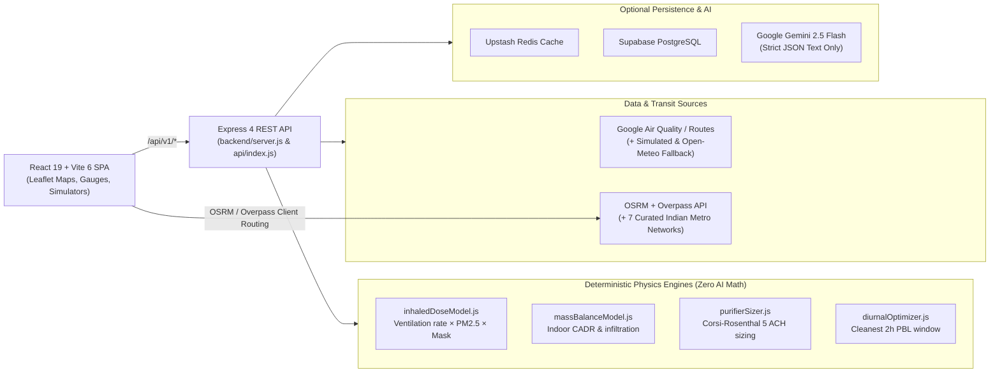
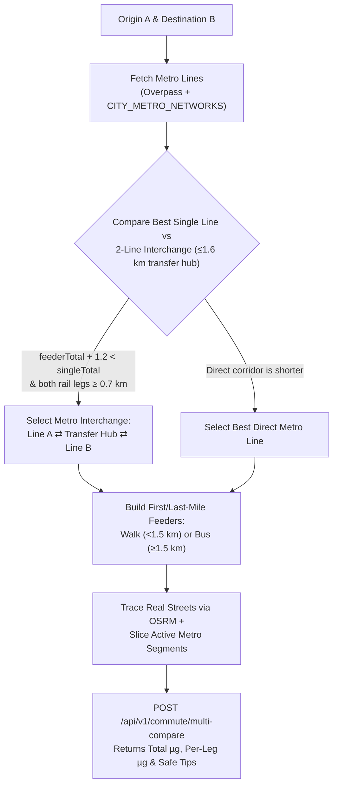

<div align="center">

# 🍃 AuraPulse

**Hyper-local Air Quality Action Planner, Multi-Modal Commute Dose Calculator & Indoor Air Simulator**

[](https://aurapulse-roan.vercel.app)
[](https://nodejs.org/)
[](https://react.dev/)
[](https://expressjs.com/)
[](backend/tests)
[](#license)

<p>
  <a href="https://aurapulse-roan.vercel.app"><strong>🌐 Live App</strong></a> •
  <a href="#-quick-start"><strong>⚡ Quick Start</strong></a> •
  <a href="#-architecture"><strong>🧩 Architecture</strong></a> •
  <a href="#-api-playground"><strong>🔌 API Playground</strong></a> •
  <a href="#-one-click-deployment"><strong>🚀 Deploy</strong></a> •
  <a href="#-project-structure"><strong>📁 Structure</strong></a>
</p>

</div>

> [!TIP]
> **Live Production Deployment:** **[https://aurapulse-roan.vercel.app](https://aurapulse-roan.vercel.app)**
> AuraPulse runs out-of-the-box **without mandatory paid API keys** using Open-Meteo weather/AQI modeling, OpenStreetMap Overpass transit networks, OSRM routing, and deterministic physics engines.

---

## ✨ What AuraPulse Does

AuraPulse combines **deterministic atmospheric & respiratory physics** (zero LLM math hallucination) with structured plain-language recommendations across four interactive workspaces:

| Workspace | Capabilities | Interactive Controls |
| :--- | :--- | :--- |
| **🌤️ Air Quality** | Live AQI & $\text{PM}_{2.5}$ readout beside the hero Outdoor vs Indoor live gauge, plus 48-hour Planetary Boundary Layer (PBL) diurnal optimization. | City/GPS location search (`EN` / `हिं` / `తె`), cleanest 2-hour outdoor & ventilation windows. |
| **🚗 Commute** | Side-by-side comparison across **Car, Two-Wheeler, Metro, Bus, Walk & Bicycle** with viewport AQI color grid overlay and map hover per-leg $\mu\text{g}$ dose tooltips. | Automated **First/Last-Mile Feeder (`Walk`/`Bus`)** & cross-city **2-Line Metro Interchange (`Line A ⇄ Transfer Hub ⇄ Line B`)**. |
| **👨‍👩‍👧 Family Plan** | Per-person risk breakdown cards across family profiles (asthma, pregnancy, seniors, children) with tailored outdoor & mask guidance. | Clickable member selector cards & language switching (`English`, `Hindi`, `Telugu`). |
| **🏠 Indoor Air** | Indoor $\text{PM}_{2.5}$ mass-balance simulation with safe `35` threshold markers, automatic room-volume CADR sizing, and animated DIY purifier builder. | Live 3-input sliders (room size, window seal, indoor smoke sources) & 3D Corsi-Rosenthal animation. |

---

## 🧩 Architecture



<details>
<summary><strong>🚇 How Automated Cross-City Metro Interchange Routing Works (Click to Expand)</strong></summary>



- **Curated Indian Metro Fallbacks (`frontend/src/utils/transitService.js`):** Pune, Delhi NCR, Mumbai, Bengaluru, Hyderabad, Chennai, and Kolkata (merged cleanly with Overpass results and official line colors).
- **Selected vs Unselected Map Rendering:** Active metro corridor & interchange legs highlight in bold official line colors with white halos and a `<CircleMarker>` hub tooltip; unused lines stay visible in thin `4px` light strokes; hovering any feeder or rail leg displays its isolated $\mu\text{g}$ dose tooltip.

</details>

---

## ⚡ Quick Start

### Prerequisites

- **Node.js `>= 20`** (`npm` bundled)
- **Git**

### Interactive Local Setup

<details open>
<summary><strong>1️⃣ Clone & Install All Workspaces</strong></summary>

```bash
git clone https://github.com/yash-kumawat-0/aurapulse.git
cd aurapulse
npm run install:all
```

</details>

<details open>
<summary><strong>2️⃣ Configure Environment Variables (Optional Keys Supported)</strong></summary>

Copy `.env.example` into `backend/.env`:

```bash
# macOS / Linux
cp .env.example backend/.env

# Windows PowerShell
Copy-Item .env.example backend\.env
```

If you deploy the frontend separately from the Express API, copy `frontend/.env.example` to `frontend/.env` and set `VITE_API_URL`.

| Variable | Where | Required? | Purpose & Fallback Behavior |
| :--- | :--- | :--- | :--- |
| `PORT` | Backend | No (`5000`) | HTTP port for the Express server |
| `NODE_ENV` | Backend | No (`development`) | Enables production error formatting |
| `FRONTEND_URL` | Backend | No | Comma-separated CORS origins (same-origin requests are auto-allowed) |
| `GOOGLE_MAPS_API_KEY` | Backend | Optional | Live Google Air Quality & Routes; falls back to realistic local + Open-Meteo models |
| `GEMINI_API_KEY` | Backend | Optional | Natural-language advice via `gemini-2.5-flash`; falls back to built-in structured advice |
| `SUPABASE_URL`, `SUPABASE_ANON_KEY`, `SUPABASE_SERVICE_ROLE_KEY` | Backend | Optional | Persisting family profiles in PostgreSQL |
| `UPSTASH_REDIS_URL`, `UPSTASH_REDIS_TOKEN` | Backend | Optional | Geohash response caching (`withCache`) |
| `VITE_API_URL` | Frontend | Optional | External backend base URL for split frontend hosting |

</details>

<details open>
<summary><strong>3️⃣ Run in Development, Production Unified Mode, or Test</strong></summary>

```bash
# Development mode — Backend (:5000 with watch) + Vite Frontend (:5173 with /api proxy)
npm run dev

# Unified Production mode — Builds frontend/dist & serves SPA + API from Express (:5000)
npm run build
npm start

# Run backend physics unit tests (Node built-in test runner)
npm test
```

</details>

---

## 🔌 API Playground

All endpoints live under **`/api/v1`** (plus **`GET /api/health`**), rate-limited in `backend/src/middleware/rateLimiter.js` (`100 req / 15 min` general, `20 req / 15 min` on `/advice/generate`).

| Method | Endpoint | Description |
| :--- | :--- | :--- |
| `GET` | `/api/health` | Service health check (`status`, `service`, `timestamp`) |
| `GET` | `/api/v1/aqi/current?lat=&lng=` | Current AQI, $\text{PM}_{2.5}$, and pollutant breakdown |
| `GET` | `/api/v1/aqi/diurnal?lat=&lng=` | 48-hour forecast, weather, and cleanest 2h ventilation window |
| `POST` | `/api/v1/commute/compare` | 2-route deterministic exposure comparison (`DRIVE`, `TWO_WHEELER`, `TRANSIT`, `WALK`, `BICYCLE`) |
| `POST` | `/api/v1/commute/multi-compare` | Multi-mode + automated multi-leg (`BUS`, `METRO`, `TRANSFER`, `WALK`) comparison |
| `POST` | `/api/v1/commute/multi-leg` | Leg-by-leg custom trip dose breakdown |
| `POST` | `/api/v1/indoor/simulate` | Indoor $\text{PM}_{2.5}$ simulation + branded & DIY Corsi-Rosenthal sizing |
| `POST` | `/api/v1/advice/generate` | Personalized family action plan (`English`, `Hindi`, `Telugu`) |
| `GET/POST/DELETE` | `/api/v1/family` | Read, create, or delete family member profiles (`Supabase`) |

<details>
<summary><strong>🧪 Copy-Paste cURL Requests Against Live Deployment</strong></summary>

```bash
# 1. Health Check
curl https://aurapulse-roan.vercel.app/api/health

# 2. Live AQI & Diurnal Windows (Pune coordinates)
curl "https://aurapulse-roan.vercel.app/api/v1/aqi/current?lat=18.5915&lng=73.7200"
curl "https://aurapulse-roan.vercel.app/api/v1/aqi/diurnal?lat=18.5915&lng=73.7200"

# 3. 5-Leg Cross-City Metro Interchange Comparison
curl -X POST https://aurapulse-roan.vercel.app/api/v1/commute/multi-compare \
  -H "Content-Type: application/json" \
  -d '{
    "origin": { "latitude": 18.5915, "longitude": 73.7200 },
    "routes": [{
      "mode": "METRO",
      "label": "Pink Line ⇄ Aqua Line",
      "distance_km": 30.3,
      "duration_min": 75,
      "legs": [
        { "role": "first", "mode": "BUS", "distance_km": 2.2, "duration_min": 10 },
        { "role": "main", "mode": "METRO", "distance_km": 18.7, "duration_min": 36 },
        { "role": "transfer", "mode": "TRANSFER", "distance_km": 0.1, "duration_min": 4 },
        { "role": "main", "mode": "METRO", "distance_km": 7.4, "duration_min": 16 },
        { "role": "last", "mode": "BUS", "distance_km": 1.9, "duration_min": 9 }
      ]
    }]
  }'

# 4. Indoor Air + DIY Purifier Simulation
curl -X POST https://aurapulse-roan.vercel.app/api/v1/indoor/simulate \
  -H "Content-Type: application/json" \
  -d '{"outdoor_pm25":85,"room_area_sqft":180,"ceiling_height_ft":10}'
```

</details>

<details>
<summary><strong>🧮 Physics Multipliers & DIY Purifier Presets</strong></summary>

Verified in [`backend/src/controllers/commuteController.js`](backend/src/controllers/commuteController.js) & [`backend/src/engine/purifierSizer.js`](backend/src/engine/purifierSizer.js):

| Mode | Road/Cabin $\text{PM}_{2.5}$ Factor | Activity Ventilation Profile |
| :--- | :---: | :--- |
| `METRO` | `0.30×` | `resting_in_vehicle` |
| `TRANSFER` | `0.35×` | `walking_slow` |
| `TRANSIT` | `0.40×` | `resting_in_vehicle` |
| `BUS` | `0.60×` | `resting_in_vehicle` |
| `WALK` | `1.00×` | `walking_brisk` |
| `DRIVE` | `1.20×` | `resting_in_vehicle` |
| `BICYCLE` | `1.30×` | `cycling` |
| `TWO_WHEELER` | `1.40×` | `two_wheeler` |

- **DIY Purifier Sizing (`recommendDIYPurifier`):** Computes target CADR for **5 air changes per hour** (`volumeM3 * 5`) across `basic_single` (`180 m³/h`), `standard_cube` (`350 m³/h`), and `large_cube` (`450 m³/h`).

</details>

---

## 🚀 One-Click Deployment

AuraPulse is pre-configured for **Vercel**, **Render**, and **Docker** out of the box:

<div align="left">

[](https://vercel.com/new/clone?repository-url=https%3A%2F%2Fgithub.com%2Fyash-kumawat-0%2Faurapulse)
[](https://render.com/deploy?repo=https://github.com/yash-kumawat-0/aurapulse)

</div>

<details>
<summary><strong>Deployment Configuration Details (Vercel / Render / Docker)</strong></summary>

- **Vercel (`vercel.json` + `api/index.js` + `.vercelignore`):**
  - Serves `frontend/dist` statically via Edge CDN and routes `/api/(.*)` to Express wrapped cleanly in [`api/index.js`](api/index.js).
  - `.vercelignore` excludes `Dockerfile` so Vercel builds Vite + Node Serverless natively instead of Container mode.
- **Render (`render.yaml`):**
  - Single Web Service blueprint running `npm run build` and `npm start`, health-checked at `/api/health`, where `backend/server.js` automatically serves `frontend/dist` + `/api/v1/*` on one origin.
- **Docker (`Dockerfile` + `.dockerignore`):**
  ```bash
  docker build -t aurapulse .
  docker run -p 5000:5000 --env-file backend/.env aurapulse
  ```

</details>

---

## 📁 Project Structure

<details>
<summary><strong>Explore Directories & Key Modules</strong></summary>

```text
aurapulse/
├── api/
│   └── index.js                  # Vercel serverless bridge to Express app
├── backend/
│   ├── src/
│   │   ├── config/               # env.js, db.js, redis.js, gemini.js, googleApi.js
│   │   ├── controllers/          # aqi, commute, indoorAir, advice, family
│   │   ├── engine/               # inhaledDoseModel, massBalanceModel, purifierSizer, diurnalOptimizer
│   │   ├── middleware/           # cacheMiddleware, errorHandler, rateLimiter
│   │   ├── routes/               # apiRoutes -> /aqi, /commute, /indoor, /advice, /family
│   │   └── services/             # googleAirQuality, googleRoutes, openMeteo, geminiAdvice
│   ├── tests/                    # inhaledDose.test.js, massBalance.test.js
│   └── server.js                 # Express API + production SPA server
├── frontend/
│   └── src/
│       ├── components/           # AqiSummaryCard, CommuteDoseCalculator, DiurnalTimeline,
│       │                         # DiyPurifierGuide, FamilyAdviceCard, FamilyProfileList,
│       │                         # Footer, HeroLocationBanner, IndoorAirSimulator, Navbar,
│       │                         # WhatsAppShareModal
│       ├── context/              # AqiContext, UserContext
│       ├── services/             # api.js (VITE_API_URL + safe JSON parsing)
│       └── utils/                # transitService, routingService, aqiRouteColorizer, geocoder
├── Dockerfile & .dockerignore    # Multi-stage node:20-alpine container
├── render.yaml                   # Render single-service Blueprint
├── vercel.json & .vercelignore   # Vercel Vite + Express serverless setup
└── package.json                  # Unified workspace scripts & dependencies
```

</details>

---

## 📄 License

Released under the [MIT License](https://opensource.org/licenses/MIT).
<sub>Environmental awareness guidance only — consult a qualified healthcare professional for medical advice.</sub>
